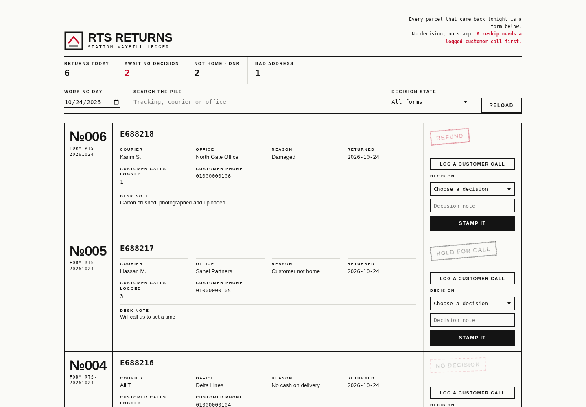

# RTS Returns Manager

The end of the day at a delivery station has a pile in it. Parcels that went out in the morning and came back at night, each one for a reason, each one waiting for somebody to decide what happens next. In most stations that decision lives in a notebook or in the supervisor's head. This app is the pile, written down properly.

Every return is logged with its tracking number, the courier who carried it, the outsourcing office he belongs to, and a reason code. DNR, refused, bad address, damaged, no cash. The supervisor works a decision queue: reship after the address is verified with the customer, hold until the customer calls, send it back to the seller, or refund. Contact attempts are counted on the record, so a reship decision cannot be made on a parcel nobody ever tried to call about. The app refuses it.

## Run it

```bash
cd backend
python3 seed.py
python3 app.py
```

Open http://127.0.0.1:8081 and sign in with the demo supervisor account, rtsdesk / demo1234. It is a demo account for a local demo, printed here on purpose. Change it before the app holds anything real. A second read only account, deskview / view1234, exists so the admin only routes can be told apart from ordinary use.

## What it does now

- Returns board by day, with reason counts, search and a waiting decision queue.
- Decision workflow with the reship rule enforced in the backend: a reship needs a logged customer contact first.
- CSV import for the night pile, described below.
- Charts drawn as inline SVG from live API data: returns by reason and a fourteen day trend. No chart library, no CDN.
- A printable daily or weekly report view on the page. Print shows only the report summary and its per day table.
- Structured JSON errors everywhere. Every failure answers `{"ok": false, "error": {"code": ..., "message": ...}}`, plus endpoint specific fields such as the missing column list on a refused import.
- A rotating log file next to the backend, configuration through environment variables, and an admin only backup endpoint.

## CSV import

POST the raw CSV text to `/api/import` with the bearer token. The Content-Type can be text/csv, the body is the file itself, capped at 500 KB.

Required columns: `tracking, courier, office, reason, day`. `customer_phone` is optional. A file missing a required column is refused whole with a 400 that names the missing columns, because half a header usually means the wrong export entirely.

Every data row then gets one of three fates, and the reply names all of them:

```json
{"ok": true, "inserted": 2, "skipped_duplicates": ["EG88213"],
 "rejected_rows": [{"row": 5, "tracking": "EG90001", "reason": "day '2026-13-40' is not a real YYYY-MM-DD date"}],
 "total_rows": 4}
```

Valid rows are inserted. A tracking number that already exists, in the database or earlier in the same file, is a duplicate and is named in `skipped_duplicates`, never inserted twice and never treated as an error. Rows with an empty tracking, courier or office, an unknown reason code, or an impossible date land in `rejected_rows` with their CSV line number and the reason. Nothing is silently swallowed.

## Configuration

Settings come from environment variables, see `config.env.example`:

| Variable | Default | Meaning |
| --- | --- | --- |
| `PORT` | 8081 | Port the server listens on |
| `DB_PATH` | backend/rts.db | SQLite database file |
| `LOG_PATH` | backend/rts.log | Rotating log file, 256 KB per file, three kept |
| `BACKUP_DIR` | backend/backups | Where backup copies land |

## Backup and restore

`POST /api/admin/backup` with the supervisor token copies the live database into the backup directory under a timestamped name such as `rts-backup-20261024-063000.db` and returns that name and its size. The copy is made with the SQLite backup API, so it is a consistent database even while the app is running. Viewer accounts get a 403.

To restore: stop the server, copy the chosen backup file over the database path from `DB_PATH`, and start the server again.

```bash
cp backend/backups/rts-backup-20261024-063000.db backend/rts.db
```

## Architecture

Python 3 standard library only, no packages to install. The backend in backend/app.py is a small REST API over SQLite, passwords stored as PBKDF2 hashes, every route except login behind a bearer token, all SQL parameterised. New in this round: a CSV import handler on the stdlib csv module, a `/api/report` range endpoint that fills quiet days into the trend instead of skipping them, a rotating file logger from logging.handlers, and the backup endpoint described above. The frontend in frontend/index.html is one page that talks to that API and nothing else, builds its charts as inline SVG strings, and carries a print stylesheet for the report view. It is responsive, so the same page works from a computer browser, an Android phone, and an iOS phone. The supervisor can check the returns board from the yard on his phone and the office can open the same board on a desktop. There is no public deployment of this demo, it runs locally.

Tests: `python3 tests/test_api.py` walks the original workflow, and `python3 tests/test_deepening.py` boots the server on its own port against a throwaway database and covers the import report, the backup file, the configuration variables and the report shape.

## The rules that matter

A return without a decision stays visible at the top of the board until it gets one. A reship needs at least one logged customer contact first, because reshipping to the same wrong address is how a parcel comes back twice. Tracking numbers are unique, a parcel cannot be logged twice by two tired people at the same time.

## Known limitations

The day board is one station and one day at a time, which matches how RTS work is actually closed out, but a multi station operation would need a station field on every record. Customer phone numbers in the seed are invented placeholders, and the app does not dial or message anyone. It records attempts, people still make the calls.

The import accepts one station's export at a time and holds the whole file in memory, which is fine at station scale and would need streaming for regional files. Report ranges are capped at 63 days. Login tokens live in server memory, so a restart signs everyone out, and backups are local files only, nobody ships them off the machine for you. Restores are a manual file copy on purpose: an accidental one click restore over a live returns book would be worse than the small chore.

## Screenshots



Today's returns filed as numbered waybill forms, two of them already
carrying their decision stamps. All data on this screen is fictional
demo data.
